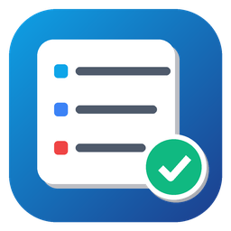
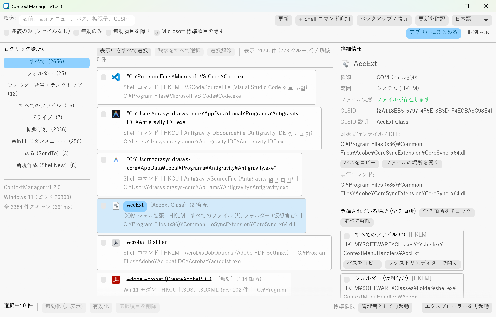

<p align="center">
  
</p>

<h1 align="center">ContextManager</h1>

<p align="center">Windows 10 / 11 エクスプローラーのコンテキストメニュー管理ツール（一覧表示・非表示・バックアップ付き削除）<br>v1.1.6</p>

<p align="center">
  <a href="README.md">English</a> | <a href="README.ko.md">한국어</a> | <a href="README.zh.md">中文(简体)</a> | <b>日本語</b>
</p>

<p align="center">
  
</p>

---

Windows 10 / 11 のエクスプローラーで右クリックした際に表示されるコンテキストメニュー項目を一覧表示し、アンインストール済みアプリの残骸を一括削除したり、安全に無効化（非表示）できるツールです。

## 主な機能

- **統合スキャン**:
  - 静的・動的 Shell コマンド（`HKCU`/`HKLM` の `*\shell`、`Directory\shell`、`Directory\Background\shell`、`Folder`、`Drive`、`DesktopBackground`、`SystemFileAssociations`、各拡張子・ProgID）
  - クラシック COM シェル拡張（`shellex\ContextMenuHandlers`）
  - Windows 11 モダンコンテキストメニュー（MSIX / Sparse Package `IExplorerCommand`）
  - 送る（`SendTo`）
  - 新規作成（`ShellNew`）
- **アプリ別グループ化と一括整理**: 同じ実行ファイル・DLL と表示名を持つ複数レジストリ登録を自動的に 1 つへまとめます。特定の分類を表示中でも他の分類にある関連件数を明示し、削除確認ダイアログからまとめて削除できます。
- **残骸項目の自動検出**: 対象の実行ファイルや DLL がディスク上に存在しない項目を `[ファイルなし - 残骸]` として強調表示します。
- **安全な無効化（非表示）と再有効化**:
  - `Shell コマンド`: `LegacyDisable` 値の切り替え
  - `COM シェル拡張` / `Win11 モダン`: `Shell Extensions\Blocked` への登録・解除
  - `送る`: `%LOCALAPPDATA%\ContextManager\disabled_sendto` との間でファイル移動
  - `新規作成`: `ShellNew` <-> `ShellNew_Disabled` へのリネーム
- **Shell コマンドの追加・編集**: すべてのファイル（`*`）、フォルダー（`Directory`）、フォルダーの背景（`Directory\Background`）、ドライブ、特定の拡張子に対して、`.bat`/`.cmd` スクリプトや `.exe` コマンドを UI から直接登録できます。ファイル/アイコン参照、`"%1"`/`"%V"`/`cmd /k` のクイック挿入、`Shift+右クリック専用(Extended)`、メニュー位置（`Top`/`Bottom`）設定、および既存の `Shell コマンド` 編集に対応しています。
- **自動バックアップとワンクリック復元**: 削除前に `%LOCALAPPDATA%\ContextManager\backups` へ `.json` と `.reg`（および `SendTo` ファイル）を自動保存し、アプリ内の「バックアップ / 復元」からいつでも元に戻せます。
- **自動アップデート**: 起動時に 1 回、および上部ツールの「更新を確認」ボタンで GitHub Releases の最新バージョンを確認し、アプリ内からダウンロードと自動インストールを実行できます。
- **多言語 UI**: デフォルトは英語で、英語・韓国語・簡体字中国語・日本語を即座に切り替えられます。
- **管理者権限での自動起動**: 起動時に UAC 昇格を行い `HKCU` と `HKLM` の両方をそのまま編集できます。レジストリエディター起動やエクスプローラー再起動にも対応しています。

## インストール

[Releases](https://github.com/workingdad365/contextmanager/releases) から `ContextManager-Setup-<バージョン>.exe` をダウンロードして実行します。

- ユーザーフォルダー（`%LocalAppData%\Programs\ContextManager`）にインストールされます
- システム全体（`HKLM`）のメニュー項目を管理するため、起動時に UAC 管理者権限を要求します
- **設定 > アプリ** からアンインストールできます（`%LocalAppData%\ContextManager\backups` のバックアップは保持されます）

## ビルドとリリース

```powershell
cargo build --release   # target\release\ContextManager.exe を生成
cargo test              # ユニットテストを実行

.\build-installer.ps1                    # dist\ContextManager-Setup-<バージョン>.exe を生成
.\build-installer.ps1 -Install           # ビルド後にサイレントインストール

.\release.ps1 "リリース内容"             # バージョンを自動更新して GitHub Release を公開
.\release.ps1 "リリース内容" -Bump minor # マイナーバージョンを更新
.\release.ps1 "リリース内容" -NoBump     # 現在のバージョンをそのまま公開
.\release.ps1 "リリース内容" -DryRun     # 次のバージョンのみ確認
```

### アイコンとスクリーンショットの再生成

```powershell
python tools/gen_icon.py
cargo build
python tools/capture_screenshots.py
```
