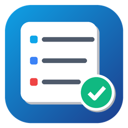
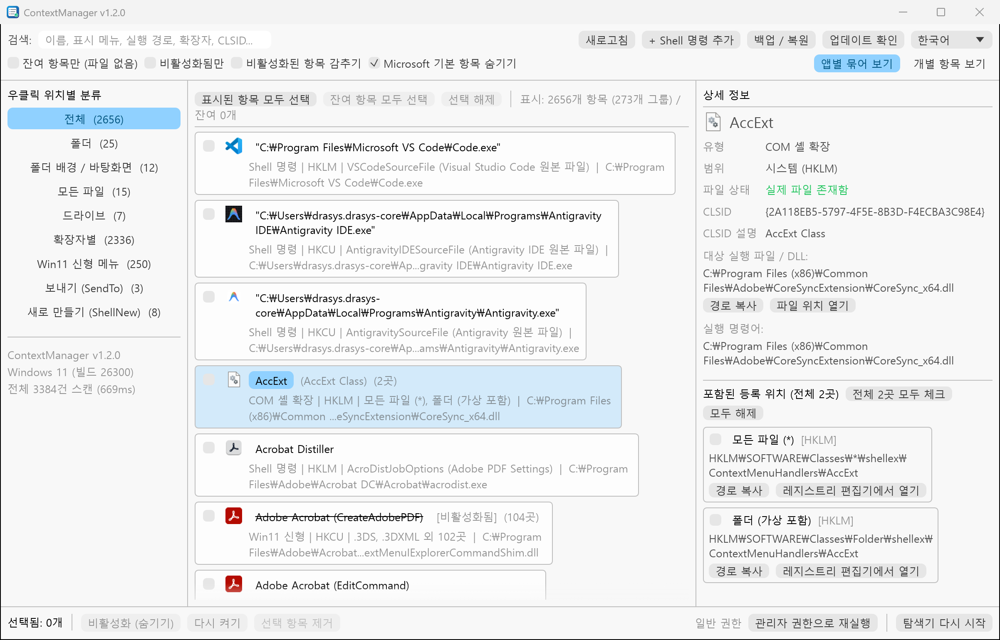

<p align="center">
  
</p>

<h1 align="center">ContextManager</h1>

<p align="center">Windows 10 / 11 탐색기 컨텍스트 메뉴를 조회하고 비활성화 및 백업 후 제거하는 관리 도구<br>v1.1.5</p>

<p align="center">
  <a href="README.md">English</a> | <b>한국어</b> | <a href="README.zh.md">中文(简体)</a> | <a href="README.ja.md">日本語</a>
</p>

<p align="center">
  
</p>

---

Windows 탐색기에서 파일, 폴더, 배경, 드라이브 등을 마우스 오른쪽 버튼으로 클릭했을 때 표시되는 컨텍스트 메뉴 항목을 한눈에 조회하고, 삭제된 프로그램의 잔여 항목을 일괄 정리하거나 안전하게 숨길 수 있다.

## 주요 기능

- **통합 스캔**:
  - 정적/동적 Shell 명령 (`HKCU`/`HKLM`의 `*\shell`, `Directory\shell`, `Directory\Background\shell`, `Folder`, `Drive`, `DesktopBackground`, `SystemFileAssociations`, 확장자/ProgID 전체)
  - 클래식 COM 셸 확장 (`shellex\ContextMenuHandlers`)
  - Windows 11 신형 컨텍스트 메뉴 (MSIX/Sparse Package `IExplorerCommand`)
  - 보내기 (`SendTo`)
  - 새로 만들기 (`ShellNew`)
- **앱별 묶어 보기 및 일괄 정리**: 실행 파일/DLL 경로와 표시 이름이 같은 여러 레지스트리 위치를 하나의 그룹으로 묶어 일괄 선택 및 제거 지원. 특정 분류에서 작업할 때도 다른 분류의 관련 항목 개수를 함께 표시하고 삭제 확인 창에서 일괄 포함 가능
- **잔여 항목 자동 탐지**: 실행 파일이나 DLL이 디스크에서 이미 삭제된 항목을 `[파일 없음 - 잔여 항목]`으로 자동 강조
- **임시 비활성화 (숨기기) 및 다시 켜기**:
  - `Shell 명령`: `LegacyDisable` 값 토글
  - `COM 셸 확장` / `Win11 신형`: `Shell Extensions\Blocked` 등록/해제
  - `보내기`: `%LOCALAPPDATA%\ContextManager\disabled_sendto`로 이동/복원
  - `새로 만들기`: `ShellNew` <-> `ShellNew_Disabled` 이름 변경
- **Shell 명령 직접 추가 및 편집**: 모든 파일(`*`), 폴더(`Directory`), 폴더 배경(`Directory\Background`), 드라이브, 특정 확장자 등에 `.bat`/`.cmd` 스크립트나 `.exe` 실행 명령을 UI에서 바로 등록 가능. 파일/아이콘 찾아보기, `"%1"`/`"%V"`/`cmd /k` 빠른 삽입, `Shift+우클릭 전용(Extended)`, 메뉴 위치(`Top`/`Bottom`) 설정 및 기존 `Shell 명령` 편집 지원
- **자동 백업 및 원클릭 복원**: 항목 제거 전 `%LOCALAPPDATA%\ContextManager\backups`에 JSON 메타데이터와 `.reg` 파일을 자동 저장하고, 프로그램 내 `백업 / 복원` 창에서 바로 복원 가능
- **자동 업데이트**: 시작 시 1회 및 상단 `업데이트 확인` 버튼으로 GitHub Releases 최신 버전을 확인하고, 앱 내에서 바로 다운로드 및 설치 가능
- **다국어 UI**: 기본 영어를 포함해 영어, 한국어, 중국어(간체), 일본어 즉시 전환 지원
- **관리자 권한 자동 실행 및 탐색기 연동**: 실행 시 관리자 권한(UAC)으로 시작하여 `HKCU`와 `HKLM` 항목을 모두 즉시 비활성화/제거할 수 있으며, 레지스트리 편집기(`regedit.exe`) 바로 열기와 탐색기 다시 시작 지원

## 설치

[Releases](https://github.com/workingdad365/contextmanager/releases) 에서 `ContextManager-Setup-<버전>.exe` 를 내려받아 실행한다.

- 사용자별 폴더(`%LocalAppData%\Programs\ContextManager`)에 설치됨
- 앱 실행 시 레지스트리(`HKLM` 포함) 편집을 위해 UAC 관리자 권한을 요청함
- **설정 > 앱** 에서 제거할 수 있으며, 백업 폴더(`%LocalAppData%\ContextManager\backups`)는 유지됨

## 빌드 및 릴리스

### 요구 사항

- Windows 10/11
- Rust 1.88 이상 (MSVC 툴체인, edition 2024)
- Visual Studio Build Tools 와 Windows SDK
- 설치 파일 생성 시: [Inno Setup 6](https://jrsoftware.org/isinfo.php) (`winget install JRSoftware.InnoSetup`)
- 릴리스 게시 시: [GitHub CLI](https://cli.github.com) (`gh auth login` 완료 상태)

### 명령

```powershell
cargo build --release   # target\release\ContextManager.exe 생성
cargo test              # 유닛 테스트

.\build-installer.ps1                    # 릴리스 빌드 후 dist\ContextManager-Setup-<버전>.exe 생성
.\build-installer.ps1 -Install           # 생성 직후 조용히 설치 (검증용)

.\release.ps1 "릴리스 설명"              # 버전 자동 증가 후 GitHub Release 게시
.\release.ps1 "릴리스 설명" -Bump minor  # minor 버전 증가
.\release.ps1 "릴리스 설명" -NoBump      # 현재 버전 그대로 게시
.\release.ps1 "릴리스 설명" -DryRun      # 다음 버전만 출력
```

### 아이콘 및 스크린샷 재생성

```powershell
python tools/gen_icon.py
cargo build
python tools/capture_screenshots.py
```
