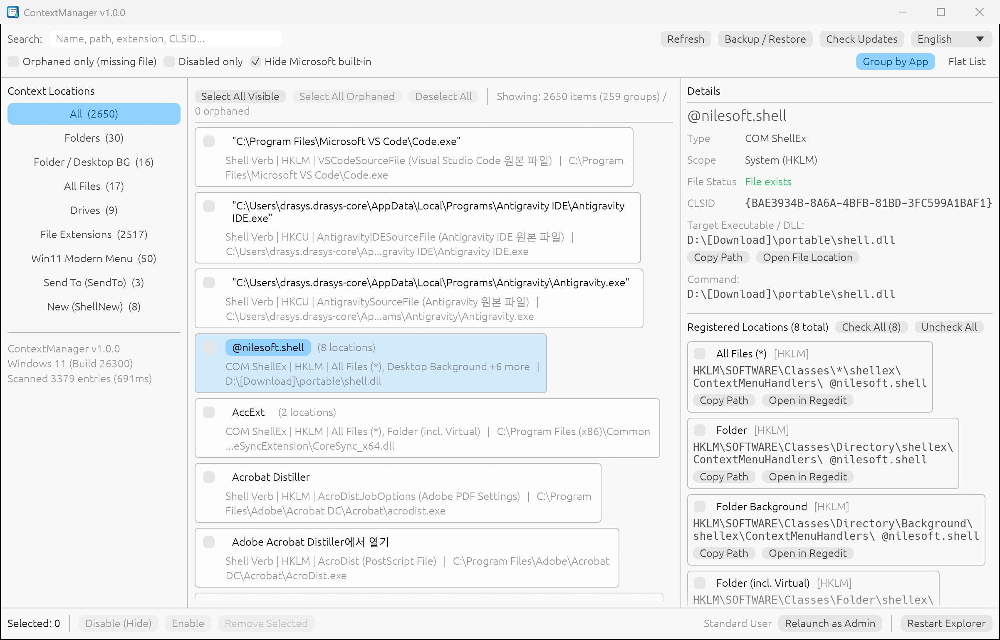

<p align="center">
  
</p>

<h1 align="center">ContextManager</h1>

<p align="center">Windows 10 / 11 File Explorer Context Menu Manager (Inspect, Disable, Backup & Remove)<br>v1.0.0</p>

<p align="center">
  <b>English</b> | <a href="README.ko.md">한국어</a> | <a href="README.zh.md">中文(简体)</a> | <a href="README.ja.md">日本語</a>
</p>

<p align="center">
  
</p>

---

ContextManager lists every right-click context menu entry in Windows 10 and Windows 11 File Explorer, highlights broken leftovers from uninstalled apps, and lets you safely hide (disable) or remove them with automatic backup and one-click restore.

## Key Features

- **Comprehensive Scanning**:
  - Static & dynamic Shell Verbs (`HKCU`/`HKLM` `*\shell`, `Directory\shell`, `Directory\Background\shell`, `Folder`, `Drive`, `DesktopBackground`, `SystemFileAssociations`, file extensions & ProgIDs)
  - Classic COM Shell Extensions (`shellex\ContextMenuHandlers`)
  - Windows 11 Modern Context Menus (MSIX / Sparse Package `IExplorerCommand`)
  - Send To (`SendTo`)
  - New Menu (`ShellNew`)
- **Group by App & Bulk Cleanup**: Automatically groups entries sharing the same executable/DLL and display name across multiple registry locations. Even when working inside a single category, shows total locations across all categories and lets you include them all in the removal dialog.
- **Orphaned Entry Detection**: Verifies whether the target executable or DLL still exists on disk and highlights missing entries as `[Missing File - Orphaned]`.
- **Non-Destructive Disable (Hide) & Re-enable**:
  - `Shell Verb`: toggles `LegacyDisable`
  - `COM ShellEx` / `Win11 Modern`: registers/removes CLSID under `Shell Extensions\Blocked`
  - `Send To`: moves files to/from `%LOCALAPPDATA%\ContextManager\disabled_sendto`
  - `New Menu`: renames `ShellNew` <-> `ShellNew_Disabled`
- **Automatic Backup & One-Click Restore**: Before deleting any entry, saves full registry snapshots (`.json` and `.reg`) and file copies under `%LOCALAPPDATA%\ContextManager\backups`. Restore anytime from the built-in **Backup / Restore** dialog.
- **Auto Update**: Checks GitHub Releases on startup and on demand via the **Check Updates** button, with in-app download progress and silent installer handoff.
- **Multilingual UI**: Default English with instant switching between English, Korean, Simplified Chinese, and Japanese.
- **Administrator Privileges & Explorer Helpers**: Starts elevated (UAC) so both `HKCU` and `HKLM` entries work immediately, with quick links to open Regedit, open file locations, and restart Windows Explorer.

## Installation

Download `ContextManager-Setup-<version>.exe` from [Releases](https://github.com/workingdad365/contextmanager/releases) and run it.

- Installs per-user under `%LocalAppData%\Programs\ContextManager`
- Prompts for Administrator (UAC) privileges on launch to edit system-wide (`HKLM`) context menu entries
- Uninstall via **Settings > Apps** (your backups in `%LocalAppData%\ContextManager\backups` are preserved)

## Build & Release

### Requirements

- Windows 10 / 11
- Rust 1.88+ (MSVC toolchain, edition 2024)
- Visual Studio Build Tools & Windows SDK
- Installer build: [Inno Setup 6](https://jrsoftware.org/isinfo.php) (`winget install JRSoftware.InnoSetup`)
- Release publishing: [GitHub CLI](https://cli.github.com) (`gh auth login`)

### Commands

```powershell
cargo build --release   # Build target\release\ContextManager.exe
cargo test              # Run unit & integration tests

.\build-installer.ps1                    # Build dist\ContextManager-Setup-<version>.exe
.\build-installer.ps1 -Install           # Build and install silently

.\release.ps1 "Release notes"              # Bump patch version and publish GitHub Release
.\release.ps1 "Release notes" -Bump minor  # Bump minor version
.\release.ps1 "Release notes" -NoBump      # Publish current version as-is
.\release.ps1 "Release notes" -DryRun      # Print next version without changing files
```

### Regenerating Icons & Screenshots

```powershell
python tools/gen_icon.py
cargo build
python tools/capture_screenshots.py
```
