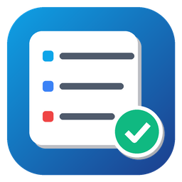
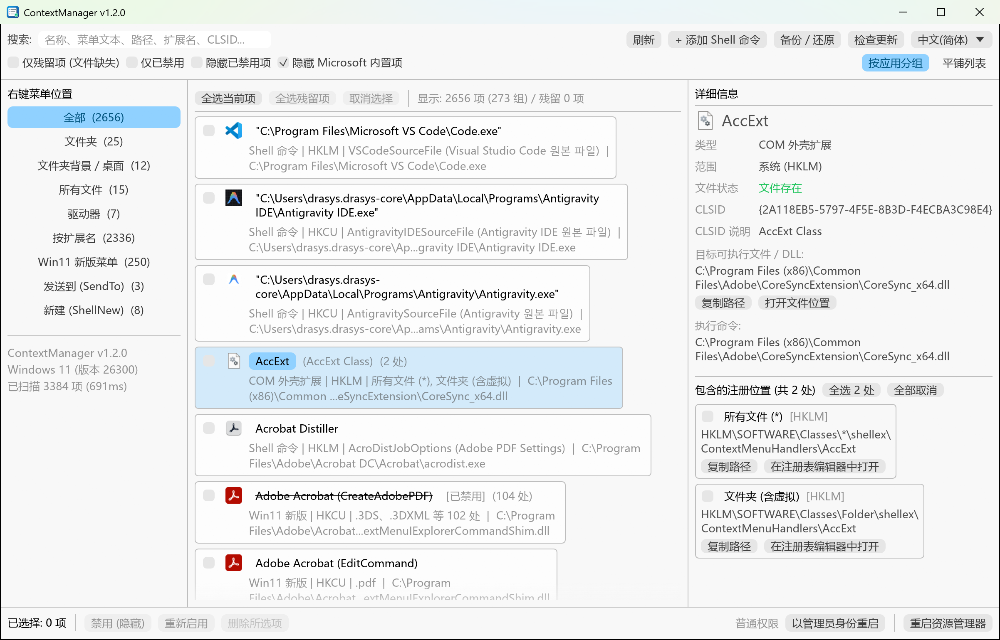

<p align="center">
  
</p>

<h1 align="center">ContextManager</h1>

<p align="center">Windows 10 / 11 资源管理器右键菜单管理工具（查看、禁用、自动备份与清理）<br>v1.1.7</p>

<p align="center">
  <a href="README.md">English</a> | <a href="README.ko.md">한국어</a> | <b>中文(简体)</b> | <a href="README.ja.md">日本語</a>
</p>

<p align="center">
  
</p>

---

ContextManager 可集中列出 Windows 10 / 11 文件资源管理器中的所有右键菜单项，自动识别已卸载软件留下的残留项，并支持无损禁用（隐藏）或自动备份后一键清除。

## 主要功能

- **全面扫描**:
  - 静态/动态 Shell 命令（`HKCU`/`HKLM` 下的 `*\shell`、`Directory\shell`、`Directory\Background\shell`、`Folder`、`Drive`、`DesktopBackground`、`SystemFileAssociations`、各扩展名与 ProgID）
  - 经典 COM 外壳扩展（`shellex\ContextMenuHandlers`）
  - Windows 11 新版右键菜单（MSIX / Sparse Package `IExplorerCommand`）
  - 发送到（`SendTo`）
  - 新建菜单（`ShellNew`）
- **按应用分组与批量清理**: 自动将同一程序分散在多个注册表位置的菜单项归为一组；即使在单个分类中操作，也会提示其他分类下的关联数量，并可在删除确认窗中一键全选清理。
- **残留项自动检测**: 检查目标可执行文件或 DLL 是否仍存在于磁盘，将缺失文件的条目高亮标记为 `[文件缺失 - 残留项]`。
- **无损禁用（隐藏）与重新启用**:
  - `Shell 命令`: 切换 `LegacyDisable` 键值
  - `COM 外壳扩展` / `Win11 新版`: 通过 `Shell Extensions\Blocked` 阻止/解除阻止
  - `发送到`: 在 `SendTo` 与 `%LOCALAPPDATA%\ContextManager\disabled_sendto` 之间移动文件
  - `新建`: 重命名 `ShellNew` <-> `ShellNew_Disabled`
- **添加与编辑 Shell 命令**: 可直接在界面中为所有文件（`*`）、文件夹（`Directory`）、文件夹背景（`Directory\Background`）、驱动器或指定扩展名注册自定义 `.bat`/`.cmd` 脚本或 `.exe` 命令，支持浏览选择文件/图标、快捷插入 `"%1"`/`"%V"`/`cmd /k`、`Shift+右键显示(Extended)` 与菜单位置（`Top`/`Bottom`），并可直接编辑现有 `Shell 命令`。
- **自动备份与一键还原**: 删除前自动在 `%LOCALAPPDATA%\ContextManager\backups` 中保存完整的 `.json` 元数据与 `.reg` 注册表文件（以及 `SendTo` 文件副本），随时可在“备份 / 还原”窗口中恢复。
- **自动更新**: 启动时自动检查一次，也可点击顶部“检查更新”按钮手动检测 GitHub Releases 新版本，并直接在应用内下载与静默安装。
- **多语言界面**: 默认英文，支持在界面中实时切换英文、韩文、简体中文与日文。
- **自动以管理员权限运行**: 启动时自动请求 UAC 管理员权限，可直接操作 `HKCU` 与 `HKLM` 项，并提供快速打开注册表编辑器、打开文件位置与重启资源管理器功能。

## 安装

前往 [Releases](https://github.com/workingdad365/contextmanager/releases) 下载 `ContextManager-Setup-<版本>.exe` 并运行。

- 安装到当前用户目录（`%LocalAppData%\Programs\ContextManager`）
- 运行时会请求 UAC 管理员权限以管理系统级（`HKLM`）右键菜单
- 可在 **设置 > 应用** 中卸载（`%LocalAppData%\ContextManager\backups` 中的备份会保留）

## 构建与发布

```powershell
cargo build --release   # 生成 target\release\ContextManager.exe
cargo test              # 运行单元测试

.\build-installer.ps1                    # 生成 dist\ContextManager-Setup-<版本>.exe
.\build-installer.ps1 -Install           # 构建并静默安装

.\release.ps1 "发布说明"                 # 自动递增版本并发布到 GitHub Release
.\release.ps1 "发布说明" -Bump minor     # 递增次版本号
.\release.ps1 "发布说明" -NoBump         # 按当前版本直接发布
.\release.ps1 "发布说明" -DryRun         # 仅预览下一版本号
```

### 重新生成图标与截图

```powershell
python tools/gen_icon.py
cargo build
python tools/capture_screenshots.py
```
